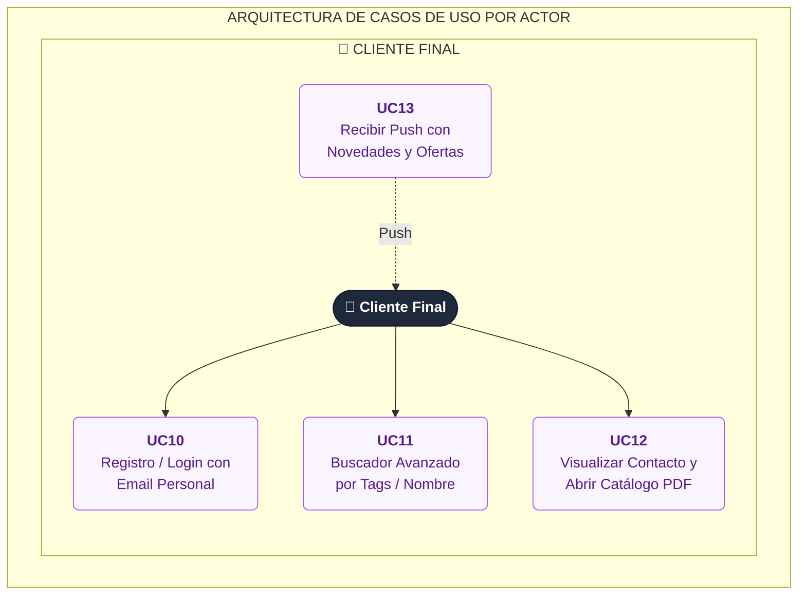

# DistroYaClient
- UC10: Registro / Login con Email Personal 
- UC11: Buscador Avanzado de Proveedores por Tags / Nombre
- UC12: Visualizar Contacto y Abrir Catálogo PDF del Proveedor
- UC13: Recibir Push con Novedades y Ofertas 

# Caso de Usos

